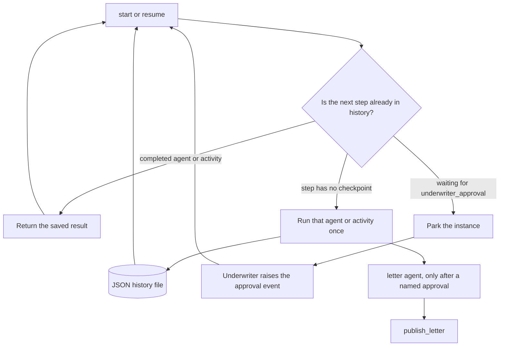

# Durable Task for Microsoft Agent Framework (`src/agentplatform/durable_agents/`)

An offline checkpoint and resume path for a multi-agent loan review. Completed model calls stay in the history and are not executed again after the process starts over. The underwriter wait is durable: the run parks with no further model calls until the decision arrives.

**Sections:** [1. Purpose](#1-purpose) · [2. Architecture](#2-architecture) · [3. How it works](#3-how-it-works) · [4. Key files](#4-key-files) · [5. Code excerpts](#5-code-excerpts) · [6. Configuration](#6-configuration) · [7. Commands](#7-commands) · [8. Real output](#8-real-output) · [9. Tests and eval gates](#9-tests-and-eval-gates) · [10. Guardrails](#10-guardrails) · [11. Security and governance](#11-security-and-governance) · [12. Observability](#12-observability) · [13. Failure modes](#13-failure-modes) · [14. Mapping to Azure services](#14-mapping-to-azure-services) · [15. Limitations](#15-limitations) · [16. Interview talking points](#16-interview-talking-points) · [17. Adopt this](#17-adopt-this)

Source: [Durable Task extension for Microsoft Agent Framework](https://learn.microsoft.com/en-us/azure/durable-task/sdks/durable-agents-microsoft-agent-framework).

## 1. Purpose

Make a multi-agent workflow survive a process restart, including a human approval that can sit for as long as the business needs, and prove that finished model calls are not billed or repeated on the way back.

## 2. Architecture



## 3. How it works

1. `loan_review_orchestration` yields intake, then credit, then `wait_for_event("underwriter_approval")`.
2. `DurableAgentApp.drive` writes each finished step to a JSON file before it continues. A new process loads that file.
3. On resume the orchestration code runs again from the top. Each yield that already has a completion returns the saved result. `DurableAgent.run` is not called for those steps.
4. A missing approval leaves `status` at `waiting`. No letter call is made.
5. A named approval continues to the letter agent and `publish_letter`. A denial, or an approval with an empty name, returns the file and skips both.
6. A step that ran and then crashed before its completion is in `attempts` and not in `execution_log`. Resume runs that step again. Earlier completed steps stay at one attempt.

## 4. Key files

| File | What it holds |
|---|---|
| `src/agentplatform/durable_agents/runtime.py` | `JsonHistoryStore`, `DurableAgentApp.drive`, external events |
| `src/agentplatform/durable_agents/loan.py` | Intake, credit, letter, publish, `loan_review_orchestration` |

## 5. Code excerpts

<!-- code: src/agentplatform/durable_agents/runtime.py::DurableAgentApp.drive -->
```python
def drive(self, name: str, record: dict[str, Any]) -> dict[str, Any]:
    """Replay completed steps, then execute only the step that has no checkpoint."""
    context = OrchestrationContext(record["input"])
    generator = self.orchestrations[name](context)
    pending: Any = None
    position = 0
    while True:
        try:
            kind, step_name, payload = generator.send(pending)
        except StopIteration as stop:
            record["output"] = stop.value
            record["status"] = "completed"
            self.store.save(record)
            return record
        if position < len(record["events"]):
            event = record["events"][position]
            self._require_match(event, kind, step_name, payload)
            pending = event["result"]
            position += 1
            continue
        if kind == "event":
            inbox = record["inbox"].get(step_name) or []
            if not inbox:
                record["status"] = "waiting"
                self.store.save(record)
                return record
            result = inbox.pop(0)
            record["events"].append(
                {"kind": "event_raised", "name": step_name, "payload": None, "result": result}
            )
            self.store.save(record)
            pending = result
            position += 1
            continue
        pending = self._execute(record, kind, step_name, payload)
        position += 1
```
<!-- /code -->

<!-- code: src/agentplatform/durable_agents/loan.py::loan_review_orchestration -->
```python
def loan_review_orchestration(ctx: OrchestrationContext):
    application = ctx.get_input()
    loan_id = application["loan_id"]
    intake = yield ctx.call_agent("intake", loan_id)
    credit = yield ctx.call_agent("credit", loan_id)
    approval = yield ctx.wait_for_event("underwriter_approval")
    approver = approval.get("approver") or ""
    if not approval.get("approved") or not approver:
        return {"status": "returned_to_processing", "loan_id": loan_id, "approver": approver}
    letter = yield ctx.call_agent("letter", f"{loan_id}|{intake['summary']}|score {credit['score']}")
    published = yield ctx.call_activity(
        "publish_letter",
        {"loan_id": loan_id, "idempotency_key": f"{loan_id}:letter", "text": letter["text"]},
    )
    return {
        "status": "issued",
        "loan_id": loan_id,
        "approver": approver,
        "letter": letter["text"],
        "ticket": published["ticket"],
        "duplicate": published["duplicate"],
    }
```
<!-- /code -->

## 6. Configuration

| Name | Effect |
|---|---|
| History directory | `JsonHistoryStore(path)` writes one file per instance id. Tests use a temp directory. |
| `crash_before_checkpoint` | Test hook. The named step runs, then the runtime raises before appending the completion. |

The Learn samples set `AgentFunctionApp` for Azure Functions, or `DurableAIAgentWorker` plus a Durable Task Scheduler connection for your own host. [verify] Those types are not installed in this repo. Nothing here opens a scheduler connection.

## 7. Commands

```bash
python scripts/component_demos.py durable_agents
pytest tests/test_durable_agents.py -q
```

## 8. Real output

<!-- output: python scripts/component_demos.py durable_agents -->
```text
status=waiting executions=intake,credit
intake calls after restart=0
still=waiting executions=intake,credit
done=issued ticket=LET-L-2001 executions=intake,credit,letter,publish_letter
replayed intake=0 letter=1
second resume=issued executions=intake,credit,letter,publish_letter letter calls=0
```
<!-- /output -->

## 9. Tests and eval gates

<!-- output: python -m pytest --co -q -p no:cacheprovider tests/test_durable_agents.py | grep '::' -->
```text
tests/test_durable_agents.py::test_workflow_waits_without_calling_the_letter_agent
tests/test_durable_agents.py::test_completed_model_calls_are_not_reexecuted_after_resume
tests/test_durable_agents.py::test_denial_skips_the_letter_and_the_publish
tests/test_durable_agents.py::test_missing_approver_returns_the_file
tests/test_durable_agents.py::test_uncheckpointed_model_call_is_retried
tests/test_durable_agents.py::test_changed_orchestration_is_nondeterministic
tests/test_durable_agents.py::test_publish_activity_is_idempotent
```
<!-- /output -->

`test_completed_model_calls_are_not_reexecuted_after_resume` is the proof the Learn page states: after a new app loads the same history, intake and credit stay at zero calls, and a second resume after completion adds no calls.

## 10. Guardrails

- Replay compares the step name and payload with history. A reordered orchestration raises `NondeterministicOrchestration` instead of calling a different model.
- The letter agent runs only when `approved` is true and `approver` is non-empty.
- `publish_letter` keys off `idempotency_key`, so a retry of that handler returns the original ticket.
- Instance ids are a single token, so the history path cannot leave the store directory.

## 11. Security and governance

- The approval event carries the approver's name into the output. An unnamed approval is treated as a return to processing.
- History files hold the synthetic application summary, the score and the letter text. A real deployment would put that store in the same protected account as the other checkpoints.
- The wait does not call the model and does not publish.

## 12. Observability

`execution_log` is the checkpointed work. `attempts` includes a call that crashed before its checkpoint. The Learn page's Durable Task Scheduler dashboard is the hosted view of the same two facts. This sample keeps them on the JSON record.

## 13. Failure modes

| Failure | What happens |
|---|---|
| Process stops while waiting | Resume loads history, intake and credit are not called, status stays `waiting` |
| Process stops after a model call and before the completion record | That step runs again. Earlier steps stay at one attempt. |
| Orchestration code no longer matches history | `NondeterministicOrchestration`, no further calls |
| Publish handler is invoked twice with the same key | Second result is `duplicate: true` and the same ticket |
| Approval is denied or unnamed | Status `returned_to_processing`. Letter and publish do not run. |

## 14. Mapping to Azure services

| Piece | Azure service |
|---|---|
| Agent host | Azure Functions `AgentFunctionApp`, or your compute plus Durable Task Scheduler [verify] |
| History | Durable Task history. The file store is the offline stand-in. |
| Human wait | External event, the same role as a durable `request_info` pause |
| Agents | Microsoft Agent Framework agents registered with the extension. Here each `DurableAgent.run` is the model call. |

The mortgage graph in `src/agentplatform/mortgage/` checkpoints MAF supersteps with `FileCheckpointStorage` or Cosmos. This package is the other product: orchestration replay, where finished agent calls are history events.

## 15. Limitations

- [verify] `AgentFunctionApp`, `app.get_agent` and `DurableAIAgentWorker` were not imported or executed. The runtime copies the documented replay rule only.
- There is no Durable Task Scheduler, no emulator dashboard, and no Azure Functions host.
- Sessions, TTL and the 1 MB entity limit from the Learn page are not implemented.
- Agent replies are deterministic functions over synthetic files, so the test counts calls rather than model quality.

## 16. Interview talking points

- Durable replay re-runs the orchestration code and skips completed model calls. Saving the conversation is not the same thing as checkpointing the step.
- A human wait should release compute. The history file is the whole parked instance.
- If a call is not in the completion log, resume will run it again. Idempotency keys on writes cover that retry. Completed calls do not need a second model request.
- Put this next to the mortgage graph when someone asks which checkpoint you mean: superstep state in MAF, or Durable Task history for agent calls.

## 17. Adopt this

1. Copy `loan_review_orchestration` and yield one agent call per step you can afford to skip on resume.
2. Park human decisions on `wait_for_event`. Resume with `raise_event` from the approval API.
3. Give every write an idempotency key inside the activity, and keep the durable log so a completed activity is not called twice.
4. When you take the real extension, keep `test_completed_model_calls_are_not_reexecuted_after_resume` as the behaviour you still have to show.
