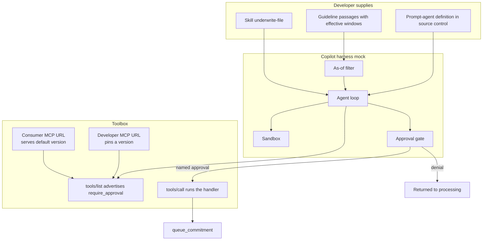

# Foundry Copilot harness and Toolboxes (`src/agentplatform/foundry_harness/`)

An offline hosted-agent sample. The managed harness owns the loop and the sandbox. The sample supplies a skill, guideline knowledge and a Toolbox exposed as one MCP endpoint. A loan commitment waits for a named human.

**Sections:** [1. Purpose](#1-purpose) · [2. Architecture](#2-architecture) · [3. How it works](#3-how-it-works) · [4. Key files](#4-key-files) · [5. Code excerpts](#5-code-excerpts) · [6. Configuration](#6-configuration) · [7. Commands](#7-commands) · [8. Real output](#8-real-output) · [9. Tests and eval gates](#9-tests-and-eval-gates) · [10. Guardrails](#10-guardrails) · [11. Security and governance](#11-security-and-governance) · [12. Observability](#12-observability) · [13. Failure modes](#13-failure-modes) · [14. Mapping to Azure services](#14-mapping-to-azure-services) · [15. Limitations](#15-limitations) · [16. Interview talking points](#16-interview-talking-points) · [17. Adopt this](#17-adopt-this)

Sources: [What's new in Foundry Agent Service at Ignite 2026](https://devblogs.microsoft.com/foundry/whats-new-in-foundry-agent-service-at-ignite-2026/), [Introducing the Microsoft Copilot harness](https://devblogs.microsoft.com/foundry/microsoft-copilot-harness-in-foundry/), [Toolbox overview](https://learn.microsoft.com/en-us/azure/foundry/agents/concepts/toolbox-overview), [Create a toolbox](https://learn.microsoft.com/en-us/azure/foundry/agents/how-to/tools/toolbox), [Use a toolbox with a hosted agent](https://learn.microsoft.com/en-us/azure/foundry/agents/how-to/tools/use-toolbox-hosted-agent).

## 1. Purpose

Show the split Foundry Agent Service draws for a prompt agent: Foundry runs the loop and the sandbox, and the team brings the knowledge, the skill and the tools. The sample is a conventional-loan commitment, with a human approval before any write.

## 2. Architecture



## 3. How it works

1. `loan-review.agent.yaml` records `harness.type: microsoft_copilot_preview`. That value is public preview. [verify] The pinned SDKs do not contain it.
2. The harness loads `SKILL.md`, keeps only guideline passages in force on the application date, and lists tools from the Toolbox consumer URL.
3. A scripted model proposes the next action. The harness allows a read, pauses a tool whose `require_approval` is `always`, or refuses shell, web fetch, files, subagents and unknown tools.
4. `tools/call` on the mock endpoint does not block an approval-gated tool. The harness does, and it adds an idempotency key before the call.
5. A named approval runs `queue_commitment` once. A denial completes the run with no write. The DTI outcome comes from `rule_decision`, using the passage params.

## 4. Key files

| File | What it holds |
|---|---|
| `src/agentplatform/foundry_harness/harness.py` | `CopilotHarness`, `select_in_force`, `HARNESS_TYPE` |
| `src/agentplatform/foundry_harness/toolbox.py` | `MockToolboxService`, consumer and developer URLs |
| `src/agentplatform/foundry_harness/loan.py` | Applications, rule, toolbox build, `start_loan_review` |
| `src/agentplatform/foundry_harness/skills/underwrite-file/SKILL.md` | The procedure the harness loads |
| `src/agentplatform/foundry_harness/definitions/loan-review.agent.yaml` | Source-controlled prompt-agent definition |

## 5. Code excerpts

<!-- code: src/agentplatform/foundry_harness/harness.py::select_in_force -->
```python
def select_in_force(passages: list[KnowledgePassage], as_of: date) -> list[KnowledgePassage]:
    """Keep passages whose effective window contains ``as_of``. The model never sees the rest."""
    return [
        passage
        for passage in passages
        if passage.effective_from <= as_of and (passage.effective_to is None or as_of <= passage.effective_to)
    ]
```
<!-- /code -->

<!-- code: src/agentplatform/foundry_harness/harness.py::CopilotHarness.continue_run -->
```python
def continue_run(self, run: HarnessRun) -> HarnessRun:
    """One managed loop. The model proposes; this method allows, pauses or refuses."""
    while run.status == "running":
        if self._turns >= self.sandbox.max_steps:
            run.status = "stopped"
            run.answer = "step budget exhausted"
            return run
        action = self.model.complete(self._context_text())
        self._turns += 1
        run.trace.append({"kind": "model", "action": action.action, "name": action.name})
        if action.action == "final":
            return self._finish(run, action)
        if action.action != "tool":
            run.status = "refused"
            run.answer = f"unsupported action {action.action}"
            return run
        refusal = self._refusal(action)
        if refusal:
            run.status = "refused"
            run.answer = refusal
            run.trace.append({"kind": "refused", "name": action.name, "reason": refusal})
            return run
        spec = self.catalog[action.name]
        arguments = dict(action.arguments)
        if spec["_meta"]["tool_configuration"]["require_approval"] == "always":
            arguments.setdefault(
                "idempotency_key", f"{arguments.get('loan_id', action.name)}:{action.name}"
            )
            run.status = "awaiting_approval"
            run.pending_tool = action.name
            run.pending_arguments = arguments
            run.trace.append({"kind": "approval_requested", "name": action.name})
            return run
        result = self.toolbox.tools_call(self.toolbox_url, action.name, arguments)
        run.trace.append({"kind": "tool", "name": action.name})
        self._notes.append(f"{action.name}={result}")
    return run
```
<!-- /code -->

<!-- code: src/agentplatform/foundry_harness/toolbox.py::MockToolboxService.tools_list -->
```python
def tools_list(self, url: str) -> list[dict[str, Any]]:
    """MCP ``tools/list``. Approval metadata is advertised and not enforced here."""
    version = self.resolve(url)
    listed = []
    for tool in version.tools:
        listed.append(
            {
                "name": tool.name,
                "description": tool.description,
                "inputSchema": tool.input_schema,
                "_meta": {"tool_configuration": {"require_approval": tool.require_approval}},
            }
        )
    return listed
```
<!-- /code -->

## 6. Configuration

| Name | Effect |
|---|---|
| `PROJECT_ENDPOINT` in `loan.py` | Fake Foundry project endpoint used to build MCP URLs. No network call. |
| `Sandbox.max_steps` | Model turns the loop may take. Default 8. |
| `Sandbox.allow_shell` and the other built-in flags | Default off for this regulated sample. |
| `PREVIEW_TOOL_POLICIES` | Stored on the toolbox version and marked `[verify]`. |

The real service reads `FOUNDRY_PROJECT_ENDPOINT`, `TOOLBOX_NAME` or `TOOLBOX_ENDPOINT`, and an Entra token for `https://ai.azure.com/.default`. This sample does not.

## 7. Commands

```bash
python scripts/component_demos.py foundry_harness
pytest tests/test_foundry_harness.py -q
```

## 8. Real output

<!-- output: python scripts/component_demos.py foundry_harness -->
```text
harness: microsoft_copilot_preview [verify] microsoft_copilot_preview is public preview and is not in the pinned SDKs
L-2001 status=awaiting_approval pending=queue_commitment in_force=['GL-DTI-200.v1']
approved status=completed ticket=CMT-L-2001 duplicate=False citation=['GL-DTI-200.v1']
L-2002 status=completed writes=0 citation=['GL-DTI-200.v1']
shell status=refused answer=sandbox refused shell
consumer before promote=['get_application', 'queue_commitment']
consumer after promote=['get_application', 'queue_commitment', 'get_reserves']
developer v1=['get_application', 'queue_commitment']
```
<!-- /output -->

## 9. Tests and eval gates

<!-- output: python -m pytest --co -q -p no:cacheprovider tests/test_foundry_harness.py | grep '::' -->
```text
tests/test_foundry_harness.py::test_harness_loads_the_skill_and_refuses_shell
tests/test_foundry_harness.py::test_unknown_tool_is_refused_and_not_called
tests/test_foundry_harness.py::test_toolbox_consumer_endpoint_follows_the_default_version
tests/test_foundry_harness.py::test_mcp_endpoint_does_not_enforce_approval_the_harness_does
tests/test_foundry_harness.py::test_denied_approval_does_not_queue_a_commitment
tests/test_foundry_harness.py::test_approval_requires_a_named_person
tests/test_foundry_harness.py::test_guideline_is_as_of_the_application_date
tests/test_foundry_harness.py::test_stale_citation_is_refused
tests/test_foundry_harness.py::test_step_budget_stops_before_the_write
tests/test_foundry_harness.py::test_agent_definition_marks_the_preview_harness
```
<!-- /output -->

There is no separate eval gate. The tests check the loop, the endpoint, the as-of citation and the approval write.

## 10. Guardrails

- The sandbox refuses shell, web fetch, files and subagents unless the flag is on.
- A tool that is not in `tools/list` is refused, and `tools/call` is not made.
- A final answer or a commitment must cite a guideline that is in force. The harness drops every other passage before the model sees context.
- `queue_commitment` waits for a non-empty approver. Denial performs no write.
- The harness sets the idempotency key. A repeated key returns the same ticket.

## 11. Security and governance

- Downstream credentials stay off the agent. The real Toolbox keeps them on the project connection. This mock has no credentials at all.
- Tool policies are preview. [verify] The version records that status and does not pretend to enforce a live RAI policy.
- The commitment names the approver on the trace entry `approved_by`.
- `microsoft_copilot_preview` is selected in the definition file, which is the creation-time choice the preview documents.

## 12. Observability

Each run keeps a `trace` list: model step, tool, refusal, approval request, approval. That list is the local stand-in for the Toolbox monitoring dashboard described in the Ignite 2026 post. No dashboard is called.

## 13. Failure modes

| Failure | What happens |
|---|---|
| Model proposes shell or another disabled built-in | `refused`, no tool call |
| Model names a tool the Toolbox did not list | `refused`, no tool call |
| Citation is outside the as-of window | `refused`, no commitment |
| Step budget is exhausted | `stopped`, reads already done stay done, no write |
| Human denies | `completed`, answer says the commitment was not queued |
| Same idempotency key is presented again | The handler returns the original ticket with `duplicate: true` |

## 14. Mapping to Azure services

| Piece | Azure service |
|---|---|
| Prompt agent and harness | Foundry Agent Service, Microsoft Copilot harness (public preview) [verify] |
| Skill and agent definition | Foundry project, authored with the portal, `azd ai`, or the VS Code toolkit |
| Toolbox | Foundry Toolbox, one managed MCP endpoint per toolbox |
| Model | Foundry model deployment. The sample uses a scripted model. |
| Write | Your system of record, behind the toolbox tool. Here it is an in-memory ledger. |

## 15. Limitations

- The loop, sandbox, Toolbox and MCP methods are in-process mocks. No Foundry resource is created and `FoundryToolbox` is not imported.
- [verify] `project.toolboxes.create_version`, `FoundryToolbox` and `microsoft_copilot_preview` are not in `azure-ai-projects` 2.6.1 or `agent-framework-foundry` 1.13.1.
- [verify] Preview tool policies are stored and not evaluated.
- The model is a fixed script, so the tests cover the harness policy rather than model quality.
- Loans, borrowers and guidelines are synthetic.

## 16. Interview talking points

- Choose the Copilot harness when the team wants skills, files and tool coordination and Foundry should own the loop. Choose a hosted agent when the team needs its own framework and loop. This repo's mortgage graph is the second shape; this sample is the first.
- `require_approval: always` is a runtime rule. The MCP endpoint still accepts `tools/call`. A system-prompt sentence does not enforce it.
- Point agents at the consumer URL. Promoting a toolbox version changes what new runs see without a new URL. The developer URL is how you inspect a version before that promotion.
- The as-of filter runs in the harness, before the model sees text, same idea as the search filter in the rest of this repo.

## 17. Adopt this

1. Copy `skills/underwrite-file/SKILL.md` and replace the steps with the procedure your reviewers already use.
2. Register each write in the Toolbox with `require_approval: always` and an idempotency key the harness sets.
3. Keep guideline params in code or in the index. Let a function compute the decision. The model cites that result.
4. When a subscription exists, replace `MockToolboxService` with the live toolbox endpoint and keep these tests as the offline contract.
