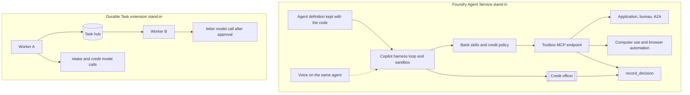

# Ignite 2026: Copilot harness, Toolboxes, and Durable Task (`src/agentplatform/ignite/`)

Offline stand-ins for two November 2026 sources this repo did not cover: the Foundry Agent Service announcement and the Durable Task extension for Microsoft Agent Framework. The scenario is a synthetic commercial-loan file with a credit-officer gate.

**Sections:** [1. Purpose](#1-purpose) · [2. Architecture](#2-architecture) · [3. How it works](#3-how-it-works) · [4. Key files](#4-key-files) · [5. Code excerpts](#5-code-excerpts) · [6. Configuration](#6-configuration) · [7. Commands](#7-commands) · [8. Real output](#8-real-output) · [9. Tests and eval gates](#9-tests-and-eval-gates) · [10. Guardrails](#10-guardrails) · [11. Security and governance](#11-security-and-governance) · [12. Observability](#12-observability) · [13. Failure modes](#13-failure-modes) · [14. Mapping to Azure services](#14-mapping-to-azure-services) · [15. Limitations](#15-limitations) · [16. Interview talking points](#16-interview-talking-points) · [17. Adopt this](#17-adopt-this)

## 1. Purpose

Show a hosted agent whose loop and sandbox belong to the platform, with bank-supplied knowledge, skills, and a Toolbox, and show a separate durable multi-agent workflow that can wait for a person and resume on a new worker without running finished model calls again.

Sources:

- [What's new in Foundry Agent Service at Ignite 2026](https://devblogs.microsoft.com/foundry/whats-new-in-foundry-agent-service-at-ignite-2026/)
- [Durable Task extension for Microsoft Agent Framework](https://learn.microsoft.com/en-us/azure/durable-task/sdks/durable-agents-microsoft-agent-framework)

## 2. Architecture



## 3. How it works

1. `commercial_loan_agent()` supplies instructions, `CREDIT-POLICY-SMB`, and three skills. The harness refuses a definition with no knowledge or no skills.
2. Skills call the Toolbox over MCP. The bureau pull is idempotent on `request_id` and requires consent. The A2A, computer-use, and browser tools are labeled stand-ins and do not leave the process.
3. The propose skill computes payment and DSCR from `money.py` and the policy's `min_dscr`. The commit skill does not run until a named officer approves. A denial does not book.
4. `recover()` reruns the handler, which is the hosted-agent rule, and skips skills already saved on the session.
5. `attach_voice()` keeps the same skills tuple. `request_browser_take_control()` pauses when the browser tool asks for Take control.
6. `DurableWorkflowWorker` checkpoints intake and credit, releases the worker, and a new worker with a new model client loads the JSON hub. Only the letter agent calls the model. Charges for the earlier calls stay on worker A.

## 4. Key files

| File | What it holds |
|---|---|
| `src/agentplatform/ignite/assumptions.py` | Source URLs, maturity labels, `ASSUMPTIONS` |
| `src/agentplatform/ignite/harness.py` | `CopilotHarness`, sandbox, voice, session store |
| `src/agentplatform/ignite/toolbox.py` | MCP Toolbox, tool policies, dashboard counters |
| `src/agentplatform/ignite/skills.py` | Bank skills and the agent definition |
| `src/agentplatform/ignite/durable.py` | Task hub, workers, model-call ledger |
| `src/agentplatform/ignite/money.py` | Payment and DSCR |
| `src/agentplatform/ignite/README.md` | Diagram, sources, assumptions, talking points |

## 5. Code excerpts

<!-- code: src/agentplatform/ignite/harness.py::CopilotHarness._enter -->
```python
async def _enter(self, run_id: str, approval: CreditDecision | None) -> HarnessRun:
    self._require_definition()
    self.handler_runs += 1
    run = self.sessions.load(run_id)
    if approval is not None:
        run.approval = approval
    elif run.approval is not None:
        approval = run.approval
    run.compute_held = True
    ctx = _BoundContext(
        application_id=run.application_id,
        knowledge={item.id: item for item in self.definition.knowledge},
        state=run.state,
        approval=approval,
        tools=self.tools,
    )
    try:
        for skill in self.definition.skills:
            if skill.name in run.completed_skills:
                continue
            if skill.requires_approval and run.approval is None:
                run.status = "awaiting_credit_officer"
                run.compute_held = False
                self.sessions.save(run)
                return run
            ctx.approval = run.approval
            await skill.run(ctx)
            run.completed_skills.append(skill.name)
            self.sessions.save(run)
    except TakeControl as exc:
        run.status = "awaiting_browser_oversight"
        run.compute_held = False
        run.state["browser"] = exc.payload
        self.sessions.save(run)
        return run
    run.status = "completed"
    run.compute_held = False
    self.sessions.save(run)
    return run
```
<!-- /code -->

<!-- code: src/agentplatform/ignite/durable.py::DurableWorkflowWorker.drive -->
```python
def drive(
    self,
    instance_id: str,
    *,
    approval: dict[str, Any] | None = None,
    stop_after: str | None = None,
) -> dict[str, Any]:
    self.compute_held = True
    state = self.hub.get(instance_id)
    done = {event["step"] for event in state["history"]}
    if "intake" not in done:
        self._agent_step(state, "intake", self._intake_prompt(state))
        if stop_after == "intake":
            return self._release(state, "running")
    if "credit" not in done:
        self._agent_step(state, "credit", self._credit_prompt(state))
        if stop_after == "credit":
            return self._release(state, "running")
    if "credit_officer" not in done:
        if approval is None:
            proposed = _step(state, "credit")["output"]
            state["pending_request"] = {
                "kind": "credit_officer",
                "application_id": state["instance_id"],
                "proposed_decision": proposed["proposed_decision"],
                "dscr": proposed["dscr"],
                "conditions": list(proposed["conditions"]),
                "prompt": "A named credit officer has to approve before booking.",
            }
            return self._release(state, "waiting")
        state["history"].append(
            {"step": "credit_officer", "kind": "approval", "output": dict(approval), "charge": None}
        )
        state["pending_request"] = None
        self.hub.save(state)
        if not approval["approved"]:
            self._activity(
                state,
                "adverse_notice",
                {
                    "officer_id": approval["officer_id"],
                    "reason": approval["reason"],
                    "booked": False,
                },
            )
            return self._release(state, "completed")
    if _approved(state) and "letter" not in done:
        self._agent_step(state, "letter", self._letter_prompt(state))
    if _approved(state) and "book" not in done:
        officer = _step(state, "credit_officer")["output"]["officer_id"]
        self._activity(
            state,
            "book",
            {
                "idempotency_key": f"book-{state['instance_id']}",
                "ticket": f"BK-{state['instance_id']}",
                "approved_by": officer,
                "booked": True,
            },
        )
    return self._release(state, "completed")
```
<!-- /code -->

<!-- code: src/agentplatform/ignite/assumptions.py::ASSUMPTIONS -->
```python
ASSUMPTIONS: tuple[str, ...] = (
    "The Foundry post presents the Microsoft Copilot harness and hosted agents as two authoring choices: a prompt agent whose loop and sandbox Microsoft runs, or your own code and orchestration on the hosted-agent runtime. This mock places a hosted agent definition on the harness (the platform still owns the loop and the sandbox; the bank supplies knowledge, skills, and tools). The post does not say a hosted agent executes inside the Copilot harness.",
    "The harness stand-in runs the bank's skills in a fixed order. The public-preview harness uses a model to choose the next tool call. There is no model call on this path.",
    "Hosted-agent long-running recovery reruns the handler, so the application has to save progress and make side effects idempotent. Idle sessions release compute and keep saved state (idle timeout is configurable from 2 minutes to 4 hours, 15 minutes by default). This mock reruns the handler and skips skills already recorded on the session. It does not implement the timeout.",
    "Network egress controls are documented for hosted agents and are enforced outside the sandbox. The harness section of the post says Microsoft runs the sandbox, but it does not describe those egress controls for harness agents. This mock blocks egress for the whole demo.",
    "Toolbox tool-policy shape is not specified (policies are in preview). The allow-list in this package is a stand-in. The same is true of the monitoring dashboard: the post names it, and the counters here are in-memory.",
    "Web Search is generally available for prompt agents, and the post says Toolbox support is coming soon, so this Toolbox does not expose Web Search. Work IQ and Fabric IQ are preview integrations and are not implemented.",
    "Voice barge-in is a flag that drops the in-progress spoken reply. The post describes interrupt, pause, and a change of direction, and native telephony. It does not publish the event schema.",
    "Browser automation's access to applications behind private virtual networks is preview. Session records flag it and do not open a socket. Recordings are labeled as customer-owned storage and are not written anywhere.",
    "The credit-officer gate is a banking control in this scenario. The harness post's named human-oversight feature is browser automation Live View and Take control, which this mock also implements. The post does not describe a credit-decision approval API.",
    "The Learn article says each durable agent call is checkpointed and that completed agent calls are not re-executed on recovery. It does not describe a billing API. This mock treats a skipped re-execution as a skipped re-bill, because another model invocation is what would add another model charge. Durable Task Scheduler charges are not modeled. Token counts are fixed per agent so tests can assert them; they are not Azure prices.",
    "Session TTL (default 14 days, minimum deletion delay 5 minutes, .NET only in the article) and the 1 MB Durable Task Scheduler entity-state limit are not implemented.",
    "Checkpoint JSON is this package's format, not the Durable Task Scheduler history table. Nothing dials a scheduler. Hosting in the article is Azure Functions (AgentFunctionApp) or your own worker against the scheduler; both are named in the docs and neither is started here.",
    "Foundry hosted-agent recovery reruns the handler. Durable Task does not re-execute a completed agent call. Those are different product behaviors and this package keeps them on separate types.",
)
```
<!-- /code -->

## 6. Configuration

This module reads no environment variables and has no Azure mode. `AAP_MODE` does not switch it on. There is no endpoint, key, or connection string.

| Input | Effect |
|---|---|
| `commercial_loan_agent(knowledge=...)` | Replaces the credit policy the skills read |
| `LoanToolbox()` | A fresh MCP server, bureau cache, and booking log |
| `TaskHub.export()` / `TaskHub.loads()` | The checkpoint a second worker resumes from |

## 7. Commands

```bash
python scripts/component_demos.py ignite
python -m agentplatform.ignite
pytest tests/test_ignite_harness.py tests/test_ignite_durable.py -q
```

## 8. Real output

<!-- output: python scripts/component_demos.py ignite -->
```text
harness status=awaiting_credit_officer compute_held=False bookings=0 hard_pulls=1
harness status=completed outcome=approve_with_conditions bookings=1 handler_runs=2
voice maturity=ga barged_in=False bookings=1
durable status=waiting compute_held=False billed_tokens=400 hard_pulls=1
durable resumed_on=worker-b model_calls=['letter'] billed_tokens=680 hard_pulls=1
```
<!-- /output -->

## 9. Tests and eval gates

There is no eval gate on this module. The tests are ordinary pytest, offline.

<!-- output: python -m pytest --co -q -p no:cacheprovider tests/test_ignite_harness.py tests/test_ignite_durable.py | grep '::' -->
```text
tests/test_ignite_harness.py::test_toolbox_mcp_endpoint_lists_the_closed_tool_set
tests/test_ignite_harness.py::test_underwriting_waits_for_a_named_officer_before_booking
tests/test_ignite_harness.py::test_approval_books_once_and_recovery_does_not_repeat_side_effects
tests/test_ignite_harness.py::test_denial_does_not_book
tests/test_ignite_harness.py::test_policy_is_supplied_by_the_bank_not_the_harness
tests/test_ignite_harness.py::test_missing_consent_blocks_the_bureau_tool
tests/test_ignite_harness.py::test_tool_policy_blocks_a_write_without_an_officer
tests/test_ignite_harness.py::test_voice_attaches_without_replacing_skills_or_booking
tests/test_ignite_harness.py::test_browser_take_control_pauses_without_fetching_a_url
tests/test_ignite_harness.py::test_egress_is_blocked_outside_the_sandbox
tests/test_ignite_harness.py::test_sources_mark_ga_capabilities_and_list_assumptions
tests/test_ignite_durable.py::test_wait_releases_the_worker_before_any_letter
tests/test_ignite_durable.py::test_new_worker_does_not_rebill_finished_model_calls
tests/test_ignite_durable.py::test_crash_after_intake_resumes_credit_on_another_worker
tests/test_ignite_durable.py::test_denial_skips_the_letter_model
tests/test_ignite_durable.py::test_bureau_replay_would_not_be_a_second_hard_pull
tests/test_ignite_durable.py::test_checkpoint_round_trip_is_plain_json
tests/test_ignite_durable.py::test_unnamed_officer_and_unknown_agent_are_rejected
```
<!-- /output -->

## 10. Guardrails

- The harness does not invent knowledge or skills.
- `record_decision` is blocked by the preview tool-policy stand-in when `approved_by` is blank, and the tool rejects it again.
- Bureau pulls require consent and do not double-pull a `request_id`.
- Voice and browser Take control cannot book.
- Egress from the sandbox stand-in is refused.
- A new durable worker does not call `ModelClient.complete` for a step already in the checkpoint.
- A denial writes an adverse notice and does not call the letter agent.

## 11. Security and governance

- Applications, scores, and the relationship-manager exposure are synthetic.
- The module holds no secrets and opens no socket. Browser recordings are a URI label, not stored bytes.
- The checkpoint contains the borrower's financial fields. A production task hub needs the same access, encryption, and retention as the loan file.
- The A2A tool here is the Foundry GA tool's stand-in (one local agent). It is not this repo's A2A directory. A production deployment would still pass that directory.
- The officer's name is stored on the booking and on the adverse notice. The narrative is not the decision record.

## 12. Observability

`LoanToolbox.dashboard()` counts calls, hard pulls, bookings, and policy blocks. That is the stand-in for the Toolbox monitoring dashboard. Each durable model charge records the agent name, token counts, and `worker_id`. `handler_runs` counts harness entries, including recovery. Nothing is exported to Azure Monitor from this package.

## 13. Failure modes

| Failure | What happens |
|---|---|
| No knowledge or skills on the definition | `HarnessError` before any tool call |
| No credit-pull consent | Bureau tool errors; hard pulls stay at 0 |
| Blank officer id | Resume and signal both refuse; nothing is booked |
| Officer denies | Outcome `declined` or an `adverse_notice` activity; no booking and no letter model call |
| Handler recovery while waiting | Handler runs again; saved skills are skipped; pulls and bookings stay put |
| Worker stops after intake | Next worker runs credit only, then waits |
| Duplicate booking key or duplicate signal | Same ticket, or no new model charge |
| Egress to an arbitrary host | `Sandbox.enforce_egress` raises |
| Browser Take control | Run pauses; `fetched_url` is false |

## 14. Mapping to Azure services

| Piece | Azure service, as the sources describe it |
|---|---|
| Loop and sandbox | Foundry Agent Service, Microsoft Copilot harness (public preview) |
| Agent definition | Foundry UI, GitHub Copilot app, Foundry CLI (`azd ai`), or the Foundry Toolkit for VS Code |
| Shared tools | Foundry Toolbox, managed MCP endpoint |
| Voice | Foundry voice agents (GA), including native telephony |
| Other agents | Foundry A2A tool (GA) |
| Screens without an API | Computer use and browser automation (GA); private-network browser access is preview |
| Hosted recovery and idle | Foundry hosted agents, long-running resiliency (GA); egress controls (GA) enforced outside the sandbox |
| Checkpoint and resume | Durable Task extension for Microsoft Agent Framework (GA) on Azure Functions or your own worker, with Durable Task Scheduler |
| Wait without compute | Durable orchestrations, and Azure Functions Flex Consumption scale-to-zero, as the article describes |

## 15. Limitations

- The full list of simplifications is `ASSUMPTIONS`, generated into the excerpt above. Highlights: the post presents the harness and hosted agents as alternatives; this demo combines them. The harness loop is a fixed skill order, not a model choosing tools. "Not re-billed" means "not re-executed," which is what the Learn article actually says.
- Token counts are fixtures. They are not Azure OpenAI or Foundry prices, and Durable Task Scheduler charges are not modeled.
- Session TTL, the 1 MB entity-state limit, memory snapshots, shared subnet IPs, private CA trust, Azure Policy, and customer-owned AKS are described in the sources and not implemented.
- Work IQ, Fabric IQ, and the Operate features (insights, annotations, Agent Optimizer) are outside this module.
- No fair-lending evaluation has been run. Do not point this demo at real applicants.

## 16. Interview talking points

Use these in an Azure and agentic-AI interview about a regulated bank. The module README has the same points with more of the product detail. This is not legal advice.

1. **The harness changes what the bank reviews.** Microsoft runs the loop and the sandbox. The bank still owns the policy text, the DSCR skill, and the tool allow-list, and those are what model risk and credit policy sign. Hosted agents are the other authoring choice when the team needs its own orchestration. Say which one you picked, and do not describe them as the same runtime.
2. **Put side effects on a Toolbox with a policy.** One managed MCP endpoint is shared. The booking tool requires a named officer both in the policy stand-in and in the tool. The bureau tool requires consent and an idempotency key so a replay is not a second hard inquiry. Credentials stay on the toolbox identity (managed identity in Azure), not in the agent definition.
3. **GA voice, A2A, computer use, and browser automation are channels and tools, not a credit authority.** Voice attaches without rewriting skills. Browser automation adds an isolated session, Live View, Take control, and recordings in customer-owned storage. A person taking the browser is not the same event as a credit officer approving the commitment.
4. **Ask which resume model the wait uses.** Hosted-agent recovery reruns the handler, so progress is saved and writes are idempotent, and idle compute is released. Durable Task checkpoints each agent call and does not run a finished call again, so a new worker after a committee wait does not add another model charge for intake or credit. The checkpoint contains customer financial data and needs loan-file controls. Remember the article's 1 MB state limit and the .NET-only session TTL.
5. **Keep the decision record boring.** Calculator output, policy id, officer id, and the idempotency key are the record. The model narrative is not parsed for the decision. A denial produces an adverse notice from the officer's reason and does not call the letter model.

## 17. Adopt this

1. Copy `LoanToolbox` and add a tool with a policy entry and, for any write, an idempotency key.
2. Keep a skill with `requires_approval` in front of every commitment, and store the officer id on the write.
3. For a wait that must survive a new process, checkpoint after each agent call the way `DurableWorkflowWorker.drive` does, and resume with a new model client against the exported hub.
4. Read `ASSUMPTIONS` before describing any of this as the behavior of Foundry or Durable Task in production.
