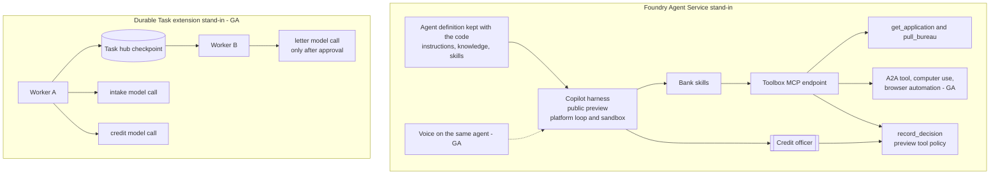

# `ignite/`: Foundry Agent Service and Durable Task, offline

Two Microsoft Ignite 2026 capabilities this repo did not demonstrate yet, both as deterministic stand-ins. No Azure call, no Durable Task Scheduler, no model, no secrets.

| Source | What this package copies |
|---|---|
| [What's new in Foundry Agent Service at Ignite 2026](https://devblogs.microsoft.com/foundry/whats-new-in-foundry-agent-service-at-ignite-2026/) | The managed **Microsoft Copilot harness** (public preview): Microsoft runs the agent loop and the sandbox; the application supplies knowledge, skills, and tools. **Toolboxes** share those tools through a managed MCP endpoint (monitoring dashboard, tool policies in preview). Generally available **voice**, the **A2A tool**, **computer use**, and **browser automation** (isolated sessions, Live View, Take control, recordings labeled for customer-owned storage; private-network access is preview). |
| [Durable Task extension for Microsoft Agent Framework](https://learn.microsoft.com/en-us/azure/durable-task/sdks/durable-agents-microsoft-agent-framework) | A multi-agent orchestration that checkpoints each agent call, waits for a person without holding compute, and continues on another worker. Completed agent calls are not run again. |

The canonical list of places this stand-in goes past those pages is `ASSUMPTIONS` in [`assumptions.py`](assumptions.py). Read it before treating a behavior as a product guarantee. The longer component page is [docs/components/ignite-2026.md](../../../docs/components/ignite-2026.md).

## Architecture



## Harness path

`commercial_loan_agent()` is the hosted agent definition: instructions, the bank's credit-policy knowledge item, and three skills (`assemble_file`, `propose_decision`, `commit_decision`). `CopilotHarness` is the platform. It refuses to run if the definition has no knowledge or no skills.

The skills call tools only through `ToolboxClient`, which speaks MCP `list_tools` / `call_tool` to an in-process `LoanToolbox` server. That is the managed endpoint. The tool list is closed: application read, an idempotent bureau pull, an in-process A2A call to a relationship-manager stand-in, a computer-use observation that drives no desktop, an isolated browser session, and `record_decision`. Web Search is absent because the post says Toolbox support is still coming (it is already GA on prompt agents). Work IQ and Fabric IQ are preview and are not implemented.

`propose_decision` computes the payment and DSCR with `money.py` and compares them to `min_dscr` on the supplied policy. The harness does not know the number 1.25. A stricter policy changes the proposal.

`commit_decision` is marked `requires_approval`. Until a named credit officer answers, the run status is `awaiting_credit_officer`, `compute_held` is false, and nothing is booked. A denial records the officer's reason and does not call `record_decision`. An approval books once; the same idempotency key returns the same ticket.

Voice is attached with `attach_voice`. The skills tuple is the same object. A spoken turn, including a barge-in that drops the reply, cannot book. Browser Take control pauses the run (`awaiting_browser_oversight`) and records a `customer-storage://` URI. `fetched_url` stays false. `Sandbox.enforce_egress` refuses a host. The post documents that control for hosted agents, enforced outside the sandbox; applying it to this harness demo is an assumption.

Hosted-agent recovery reruns the handler. `recover()` increments `handler_runs` and enters the loop again. Skills already listed on the saved session are skipped, so the bureau pull and the booking do not repeat. That is the post's rule: save progress, and make side effects idempotent. It is a different rule from Durable Task, which does not re-execute a finished agent call.

## Durable path

`DurableWorkflowWorker` registers three agents (`intake`, `credit`, `letter`) and runs them in order, checkpointing the task hub after each one. Facts (principal, DSCR, proposed decision) are copied from the synthetic application and the calculator. The narrative is a fixed string from `ModelClient`, which exists so a test can see whether a model call happened. Token counts are fixed per agent so the bill can be asserted. They are not Azure prices.

At the credit-officer step the worker sets `compute_held` to false and returns. The wait can outlive that process: `TaskHub.export()` is plain JSON, and a new `DurableWorkflowWorker` with a new `ModelClient` loads it. Finished steps are already in `history`, so `complete()` is not called for them and their charges stay on the original `worker_id`. Only the letter call is new. A second signal on a completed instance adds no charge. A denial writes an `adverse_notice` activity and does not call the letter model. The bureau log lives outside the worker; the credit step is the only caller, and a repeated request id would not be a second hard pull even if a handler ran twice.

The Learn article's hosting choices are Azure Functions (`AgentFunctionApp`) or your own worker against the Durable Task Scheduler. Neither process is started here. Session TTL (default 14 days, .NET only in the article) and the 1 MB entity-state limit are documented there and not enforced here.

## Assumptions

The short version:

- The post treats the Copilot harness and hosted agents as two authoring choices. This demo puts a hosted definition on the harness.
- The harness loop here is a fixed skill order. The preview harness uses a model to choose tool calls.
- Toolbox policy documents and the monitoring dashboard have no published schema in the post. `TOOL_POLICIES` and `dashboard()` are stand-ins.
- Voice barge-in, browser private-network access, and customer-owned recordings are modeled as fields. Nothing is stored and no socket is opened.
- The credit-officer gate is a banking control. The post's named human-oversight feature is browser Take control, which is also implemented.
- "Not re-billed" is this repo's reading of "completed agent calls are not re-executed." The article does not define a billing API. Scheduler charges are out of scope.
- Hosted-agent recovery reruns the handler. Durable Task does not re-execute a completed call. The two types in this package do not share a resume implementation.

## Interview talking points

These are the points to make in an Azure and agentic-AI conversation about a regulated lender. They describe this module and the two sources. They are not legal advice, and this repo has no fair-lending evaluation.

1. **Say which runtime owns the loop.** On the Copilot harness, in public preview, Microsoft runs the agent loop and the sandbox. The bank's change-controlled artifacts are the instructions, the credit policy (knowledge), the skills, and the tools. That split is how a model-risk team reviews the policy and the DSCR formula without also reviewing a hand-rolled tool loop. Hosted agents are the other Ignite choice: the team brings its own code and orchestration to a managed runtime. This demo places a definition on the harness and labels that combination as an assumption, because the post presents the two as alternatives. Authoring in the product is the Foundry UI, the GitHub Copilot app, `azd ai`, or the Foundry Toolkit for VS Code, with the definition kept in source control. The definition in this package is the Python object `commercial_loan_agent()`.

2. **A Toolbox is a governed tool plane, shared.** One MCP endpoint publishes the bureau read, the relationship-manager call, the UI tools, and the booking write. Preview tool policies are how a bank stops `record_decision` unless `approved_by` is set, in front of the system of record, which also refuses a blank officer. The bureau tool requires consent and reuses `request_id`, because a second hard inquiry is a customer-visible side effect and a Fair Credit Reporting Act concern a credit officer will ask about. In Azure the toolbox identity would be a managed identity; this process has no credential. The in-memory counters stand in for the monitoring dashboard the post names. Web Search stays off the Toolbox on purpose: the post says that support is coming later, while Web Search on prompt agents is already GA.

3. **GA channels do not bypass the decision.** Voice (GA) is added to the existing agent, with native telephony in the product, and barge-in is a flag here. The spoken turn cannot book. The A2A tool (GA) reaches another agent; here that agent is an in-process stand-in, separate from this repo's A2A directory. Computer use and browser automation (GA) cover a screen that has no API: the browser session is isolated, Live View and Take control are how a person supervises it, and the recording URI is labeled `customer-storage://` because the post says recordings go to customer-owned storage. Private-network access to that browser is preview and is only a field. None of those tools is allowed to be the credit decision.

4. **Name the resume semantics before you design the wait.** A credit committee can sit for days. Two GA features both sound like "it will still be there later," and they behave differently. Foundry hosted-agent long-running recovery reruns the handler, so the application saves progress and every side effect is idempotent; idle timeout is configurable from 2 minutes to 4 hours and defaults to 15 minutes, and an idle session releases compute. The Durable Task extension checkpoints each agent call and does not re-execute a completed call, so a new worker after the wait does not call the model again. This module bills a model call only inside `ModelClient.complete`. After resume, intake and credit stay charged to worker A, and worker B's client shows only `letter`. A denial is an activity (`adverse_notice`) with no letter charge. The checkpoint holds the borrower's financials, so a real task hub needs the same encryption, access, and retention as the loan file. The article's other limits still apply in production: scheduler latency, a 1 MB entity state on Durable Task Scheduler, and session TTL (default 14 days, and the article says TTL configuration is .NET only today).

5. **The model draft is not the credit decision.** DSCR and the payment come from `money.py` and from policy the bank supplied. The officer's name is stored on the booking and on the adverse notice. The durable letter narrative is written only after that approval, and the structured decision fields are not parsed out of the narrative. That is the control a model-risk and compliance review expects to see in the trace: who proposed, which policy version, who approved, and which write was idempotent. Voice, browser Take control, and a restarted worker can all reach the same file, and none of them is allowed to skip the officer.

## Run

```bash
python -m agentplatform.ignite
python scripts/component_demos.py ignite
pytest tests/test_ignite_harness.py tests/test_ignite_durable.py -q
```

| File | What it does |
|---|---|
| [`assumptions.py`](assumptions.py) | Source URLs, maturity labels from the two pages, and `ASSUMPTIONS`. |
| [`data.py`](data.py) | Synthetic applications `APP-4401` and `APP-4402`, and the credit-policy knowledge item. |
| [`money.py`](money.py) | Amortizing payment and DSCR. |
| [`toolbox.py`](toolbox.py) | `LoanToolbox` MCP server, preview tool policies, dashboard counters. |
| [`harness.py`](harness.py) | Copilot harness, sandbox egress check, voice attach, session store. |
| [`skills.py`](skills.py) | The three bank skills and `commercial_loan_agent()`. |
| [`durable.py`](durable.py) | Task hub, model-call ledger, worker, human wait, resume. |
| [`__main__.py`](__main__.py) | `python -m agentplatform.ignite`. |
